# チュートリアル: NetSim ウィンドウで同期をテストする

[English](README.md) | 日本語

NetSim に付いているサンプルワールドを使って、NetSim ウィンドウの使い方を一通り試します。コードは書きません。
所要時間は 20 分ほどです。画面は Unity 2022.3.22f1、VRChat SDK 3.10.5、NetSim 0.3.1 のものです。

サンプルワールドには、正しい同期の書き方と、わざと仕込んだバグが並んでいます。

| オブジェクト | 書き方 |
|---|---|
| `GoodCounter` | 正しい: オーナー以外はネットワークイベントでオーナーに頼み、オーナーだけが書く |
| `RacyCounter` | バグ: 「所有権を取ってから書く」。2 人がほぼ同時に押すとずれる |
| `LostWriteCounter` | バグ: 所有権を取らずに書く |
| `SyncedToggle` / `EventToggle` | 正しい / バグ: 状態をネットワークイベントだけで変える（途中参加者にずれる） |

## 1. 準備

NetSim をインストールします（[README](../../README.ja.md#インストール)。VCC なら *Manage Project* で追加）。

*Window > Package Manager* で **NetSim - Multi-client Sync Test for VRChat Worlds** を選び、**Samples** タブの
**Sample World** の **Import** を押します。

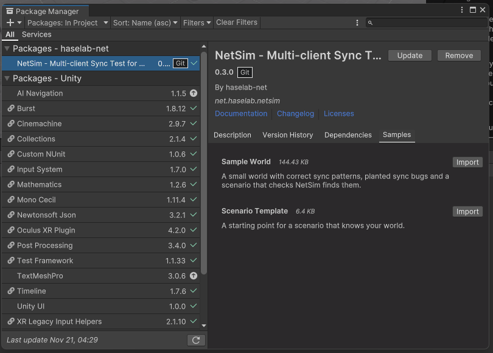

`Assets/Samples/NetSim - …/<version>/Sample World` に入るので、`SampleWorld.unity` をダブルクリックして開きます。

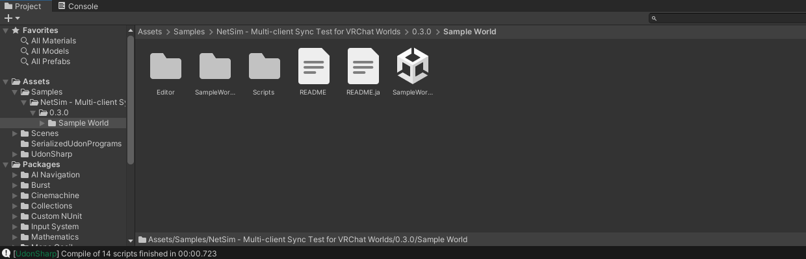

*Tools > NetSim > NetSim Window* でウィンドウを開きます。好きな場所にドッキングしてかまいません。

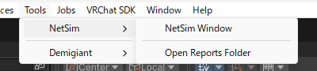

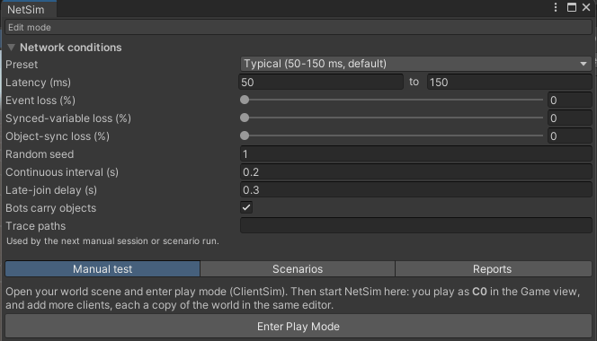

上半分の **Network conditions** がネットワークの条件で、下のタブが **Manual test**（手で試す）、**Scenarios**
（自動で試す）、**Reports**（結果）です。

## 2. ネットワークの条件を選ぶ

**Preset** で選べます。遅延は「クライアント → サーバー」「サーバー → クライアント」の各区間の片道で、
クライアント同士のメッセージはその 2 区間を通ります。今回は既定の *Typical (50-150 ms)* のままにします。

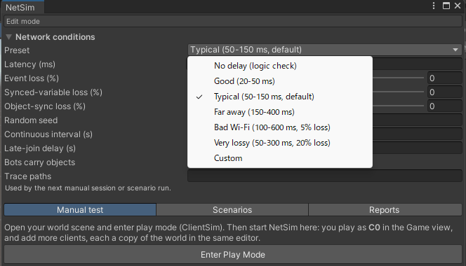

設定は `ProjectSettings/NetSimSettings.json` に保存され、シナリオやコマンドラインからの実行でも使われます。

## 3. 手で試す（Manual test）

### 3.1 クライアントを増やす

**Enter Play Mode** を押します。ClientSim の案内が出たら **Accept** を押します。そのあと Game ビューがマウスを
つかんだままになるので、**Esc** を押してマウスを放してからウィンドウを操作してください（ウィンドウの最初の
クリックは、ウィンドウを選ぶだけのことがあります）。

**Start NetSim** を押すと、自分（ClientSim のプレイヤー）が **C0** として加わります。

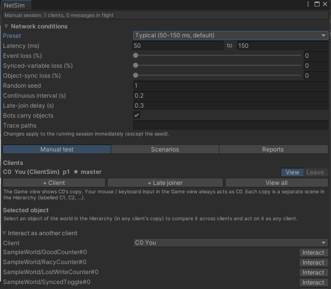

**+ Client** を 2 回押すと、C1 と C2 が加わります。各クライアントは同じシーンの写しで、同じ Editor の中で動いています。

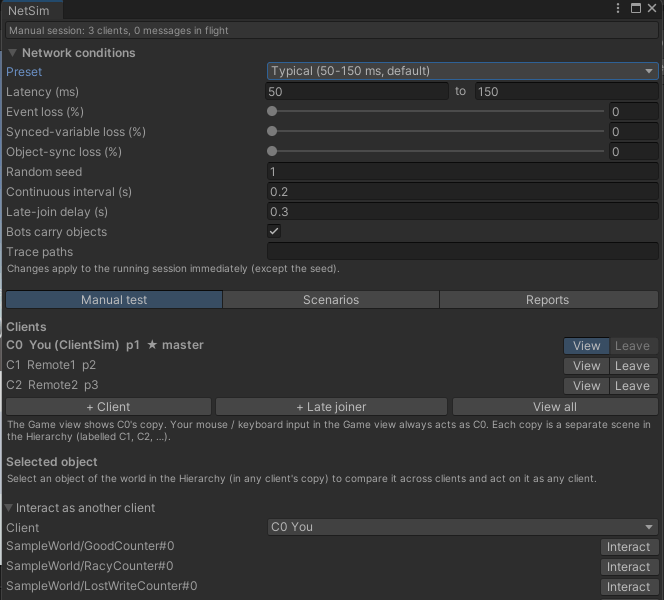

Hierarchy では、写しが別々のシーンとして並び、右に `C1 Remote1` などのラベルが付きます（`★` はマスター、
`[viewing]` は Game ビューに映しているクライアント）。

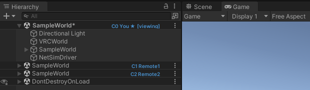

### 3.2 2 人が同時に押す

Hierarchy で C1 のシーンを開き、`SampleWorld/RacyCounter` を選びます。**Selected object** に、各クライアントでの
オーナーと同期変数が並びます。

C1 の行の **Interact** と C2 の行の **Interact** を続けて押し、**Compare now** を押します。

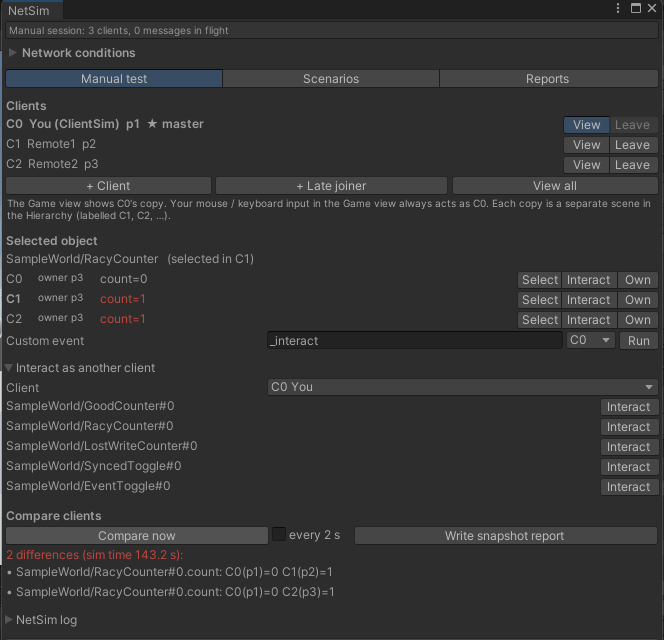

C1 と C2 は `count=1`、マスターの C0 は `count=0` のままで、赤く表示されます。2 人とも所有権を取って書いたため、
片方の書き込みはサーバーに拒否され（まだもう一方がオーナーだった）、もう片方は届いたときには新しいオーナーが
いたので捨てられました。どちらの値もマスターに届かず、次に誰かが押すまでずれたままです。これが `RacyCounter` に
仕込んだバグです。**Compare clients** の欄にも、ずれている変数が並びます。

### 3.3 ほかのクライアントの画面を見る

クライアントの行の **View** で、Game ビューに映す写しを選べます。左が C0、右が C1 を映したときで、Racy counter の
数字が違います。Game ビューでのマウスやキーボードの操作は、どれを映していても C0 として働きます。
**View all** は全部の写しを重ねて描きます。

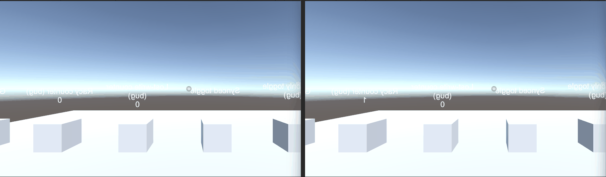

### 3.4 直す・確かめる

C0 の行の **Own**（所有権を取る）を押してから、C0 の **Interact** を押します。今度はオーナーが 1 人だけなので、
全員が同じ値になります。**every 2 s** に印を付けると、2 秒ごとに比べ直します。

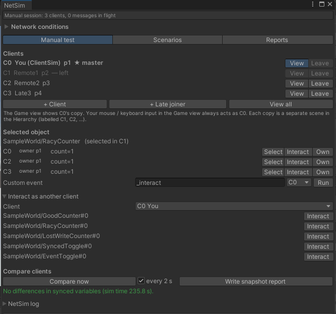

**Custom event** に `_interact` 以外のイベント名を入れ、クライアントを選んで **Run** を押すと、そのクライアントとして
任意のイベントを実行できます。**Interact as another client** には、そのクライアントがいま押せる物が並びます。

### 3.5 途中参加と退出

**+ Late joiner** で途中参加者を加え、C1 の **Leave** で C1 を退出させます。途中参加者はサーバーが持つ最新の状態を
受け取ります。マスターを退出させると、マスターの移譲を試せます（C0 は退出できないので、`master-leave` シナリオを
使います）。

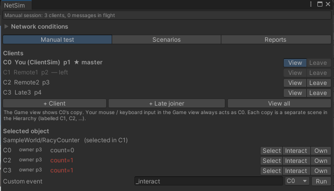

### 3.6 記録を残す

**Write snapshot report** で、差分・見た目の差分・通信の統計・ログを `Logs/NetSim/snapshot_*.md` に保存します。
**NetSim log** を開くと、参加・退出や、拒否された同期（`serialization … rejected`）が見えます。

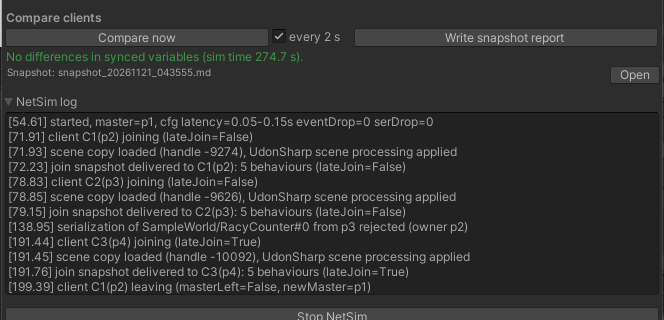

**Stop NetSim** で終わります。写しとそのプレイヤーは消え、C0 だけに戻ります。

## 4. シナリオで自動で試す（Scenarios）

### 4.1 1 つ実行する

**Scenarios** タブで **Scenario** を選びます。`(built-in)` の 4 つはどのワールドでも動きます。`sample-world` は
サンプルワールド専用で、仕込んだバグだけが見つかることを確かめます。

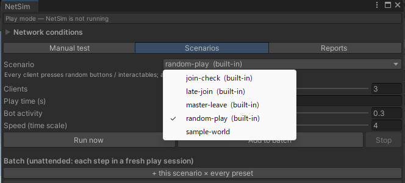

`sample-world` を選んで **Run now** を押します。

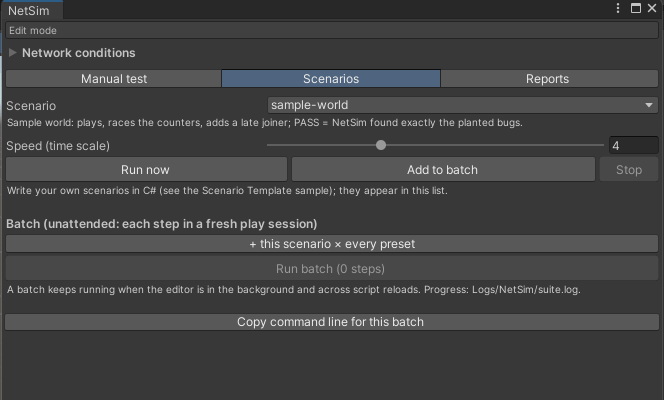

Run now は、毎回新しい Play セッションで実行します（Play モードなら一度止めて入り直します）。前に試した状態が残らないので、
結果がぶれません。**Speed** の倍率で Editor が速く進みます（ネットワークの遅延はシミュレーション上の時間のままです）。
実行中はウィンドウの上に進み具合が出て、Hierarchy にはシナリオが加えたクライアント（`Early1` など）が並びます。

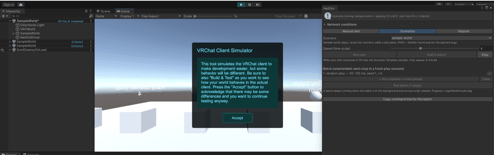

### 4.2 結果を読む

終わると **Reports** タブにレポートが加わります。**View** で中身を表示します（**Open** は既定のアプリで開きます）。

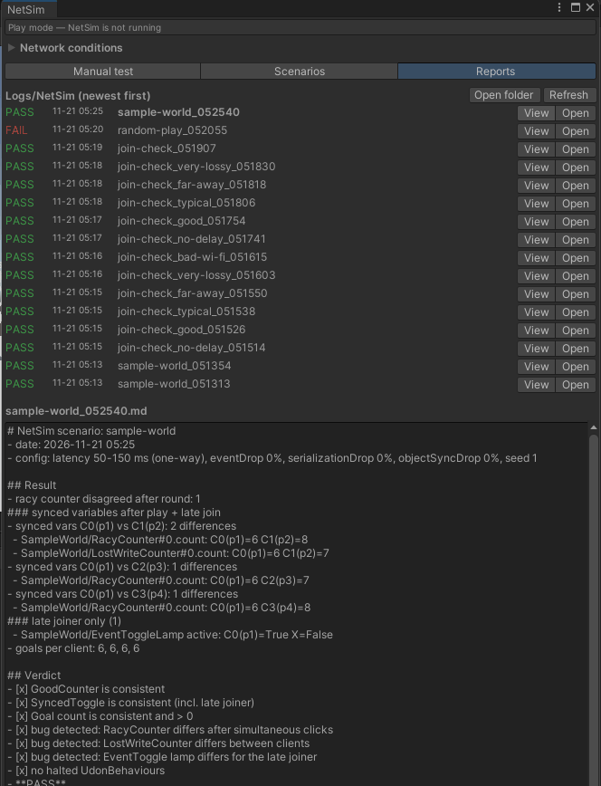

- **Result**: クライアント間で違った同期変数と、途中参加者にだけある見た目の差分
- **Verdict**: シナリオのチェック。全部に印が付けば **PASS**、1 つでも外れれば **FAIL**
- **Totals**: 通信の統計、`SetOwner` が多い物、Udon の例外で止まったビヘイビア

`sample-world` では、正しい書き方（GoodCounter, SyncedToggle, ゴール数）が一致し、仕込んだ 3 つのバグが見つかって
PASS になります。自分のワールドで `random-play` などを使うと、ずれた同期変数が FAIL として報告されます。

シナリオが終わっても Play モードのままで、写しは残ります（Hierarchy で `(stopped)`）。物の状態を Inspector で
調べられます。次に NetSim を始めると消えます。

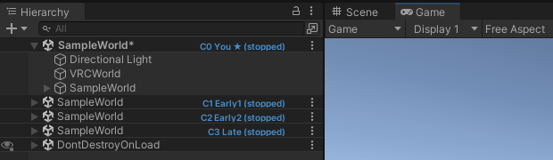

### 4.3 条件を変えてまとめて実行する

**+ this scenario × every preset** を押すと、選んだシナリオを全プリセットの条件で並べた **Batch** ができます
（**Add to batch** なら今の条件で 1 つだけ足します）。▲ で順番を変え、✕ で消せます。

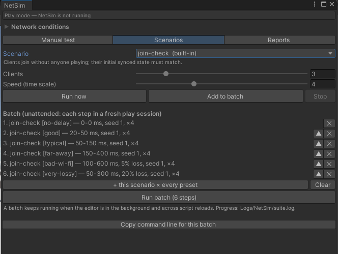

**Run batch** を押すと、1 つずつ新しい Play セッションで実行します。Editor が裏に回っていても進みます。
途中で **Stop** を押すとやめます。結果は **Results of the last batch** に並び、**View** でレポートに移ります。

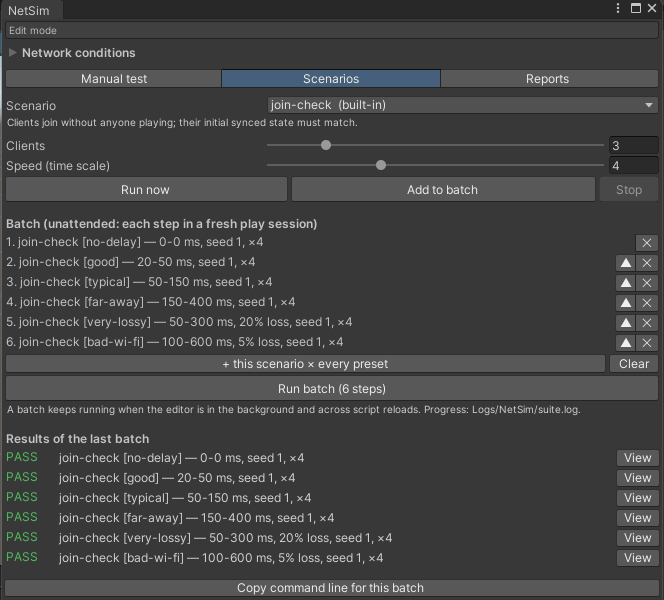

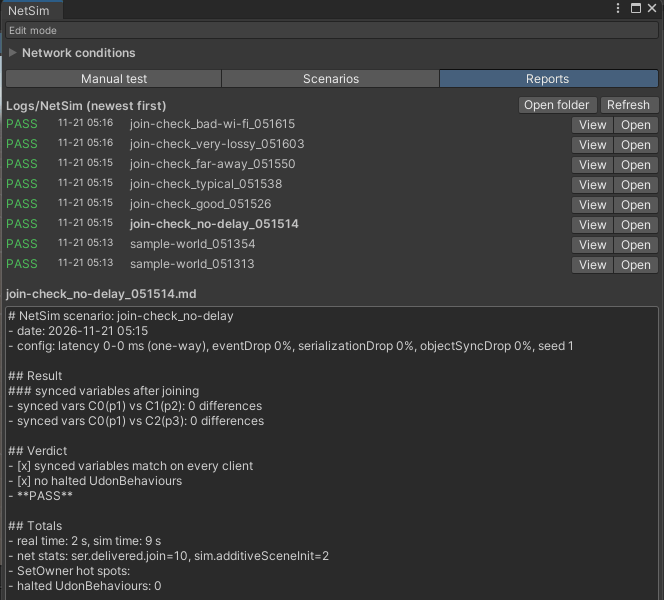

**Copy command line for this batch** は、同じバッチを Unity の画面なしで実行するコマンドをコピーします。
CI や AI エージェントに渡せます（終了コード 0 = 全部 PASS、2 = FAIL あり、1 = エラー。
[コマンドライン](../../Packages/net.haselab.netsim/Documentation~/README.ja.md#コマンドライン)）。

## 5. 自分のワールドで

1. 自分のワールドのシーンを開き、同じように **Manual test** で押してみる、`random-play` や `late-join` を実行してみる。
2. 組み込みのシナリオはランダムに押すだけです。ゲームを遊ぶシナリオを書くと、ずっと多くの問題が見つかります。
   Package Manager から **Scenario Template** サンプルをインポートし、ひな形を直してください
   （[シナリオの書き方](../../Packages/net.haselab.netsim/Documentation~/README.ja.md#シナリオの書き方)）。
3. NetSim は簡略化したモデルです。重要な結果は実機の VRChat クライアントで確かめてください（任意のパッケージ
   [NetSim Real Client Test](../../Packages/net.haselab.netsim.realclient/README.ja.md)）。
