# Tutorial: testing sync with the NetSim window

English | [日本語](README.ja.md)

This walks through the NetSim window with the sample world that comes with NetSim. No code is needed, and it takes
about 20 minutes. The screenshots are from Unity 2022.3.22f1, VRChat SDK 3.10.5 and NetSim 0.3.1.

The sample world contains correct sync patterns next to planted bugs:

| Object | Pattern |
|---|---|
| `GoodCounter` | correct: non-owners ask the owner with a network event, only the owner writes |
| `RacyCounter` | bug: "take ownership, then write"; diverges when two players press at nearly the same time |
| `LostWriteCounter` | bug: writes without taking ownership |
| `SyncedToggle` / `EventToggle` | correct / bug: state changed only by a network event (a late joiner sees it differently) |

## 1. Setup

Install NetSim (see the [README](../../README.md#installation); with VCC, add it in *Manage Project*).

In *Window > Package Manager*, select **NetSim - Multi-client Sync Test for VRChat Worlds**, open the **Samples** tab and
press **Import** next to **Sample World**.

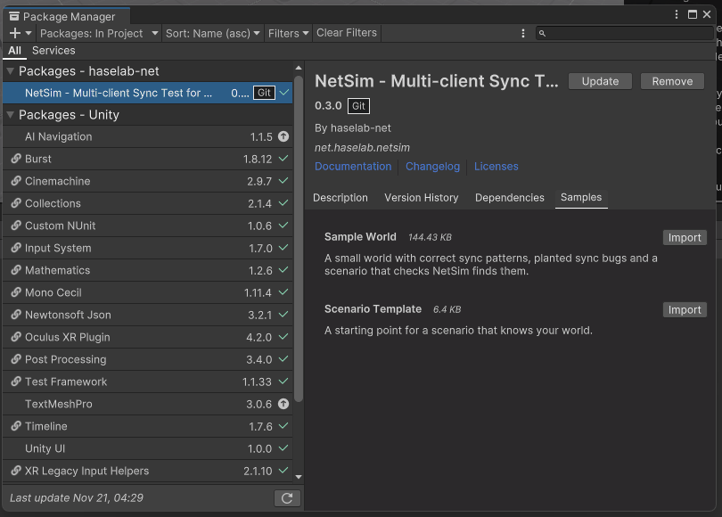

It is imported to `Assets/Samples/NetSim - …/<version>/Sample World`; double-click `SampleWorld.unity` to open it.

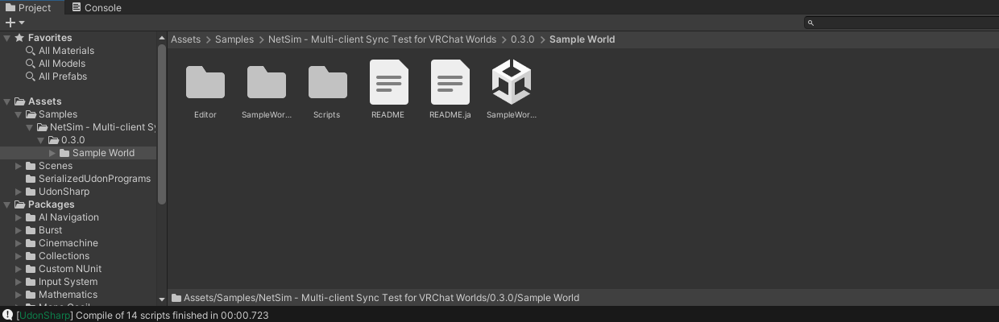

Open the window with *Tools > NetSim > NetSim Window*. Dock it wherever you like.

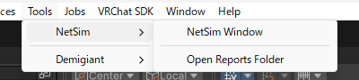

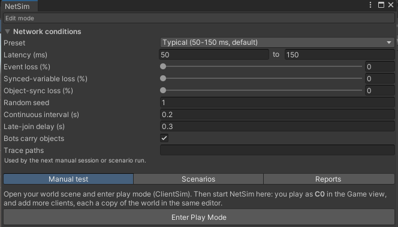

The upper part, **Network conditions**, sets up the simulated network. The tabs below are **Manual test** (try things by
hand), **Scenarios** (let NetSim play) and **Reports** (results).

## 2. Choose the network conditions

Pick a **Preset**. Latency is one way per hop (client → server, server → client); a message between two clients takes
both hops. Keep the default *Typical (50-150 ms)* for this tutorial.

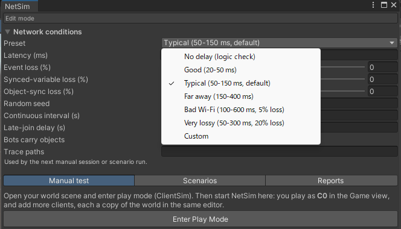

The settings are saved to `ProjectSettings/NetSimSettings.json` and are also used by scenarios and command-line runs.

## 3. Test by hand (Manual test)

### 3.1 Add clients

Press **Enter Play Mode**. When ClientSim shows its notice, press **Accept**. The Game view then keeps the mouse for
looking around; press **Esc** to release it before you use the window (the first click on the window may only focus it).

Press **Start NetSim**: you, the ClientSim player, are **C0**.

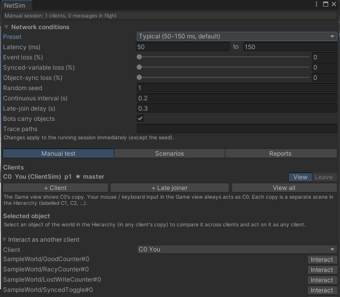

Press **+ Client** twice to add C1 and C2. Each client is a copy of the same scene, running in the same editor.

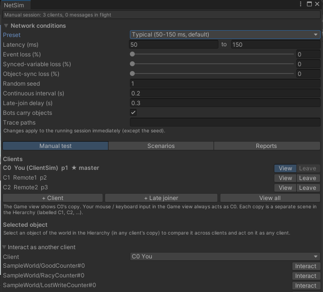

In the Hierarchy the copies are separate scenes, labelled `C1 Remote1` and so on (`★` = master, `[viewing]` = the client
shown in the Game view).

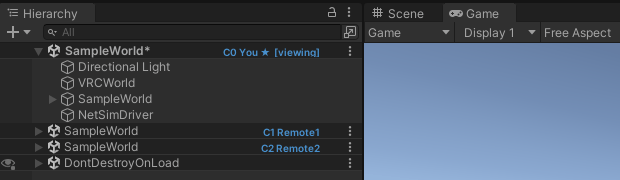

### 3.2 Two players press at once

Expand C1's scene in the Hierarchy and select `SampleWorld/RacyCounter`. **Selected object** lists its owner and synced
variables in every client.

Press **Interact** in C1's row and then in C2's row right after it, then press **Compare now**.

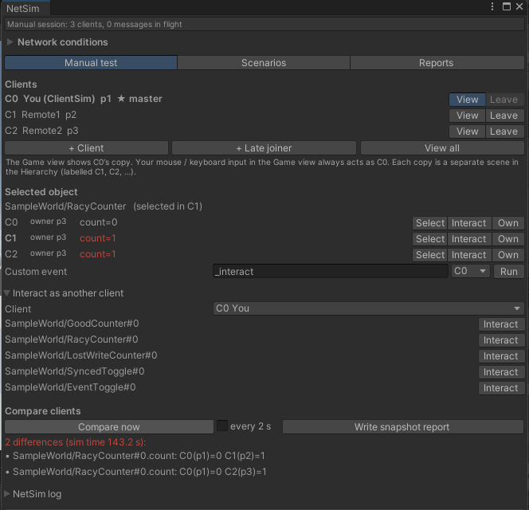

C1 and C2 show `count=1`, while the master C0 still has `count=0`, shown in red. Both clients took ownership and wrote:
the server rejected one write (the other client was still the owner) and discarded the other because a newer owner
existed by the time it arrived. Neither value reached the master, and the clients disagree until somebody presses again.
That is the bug planted in `RacyCounter`. **Compare clients** lists the differing variables.

### 3.3 See another client's world

**View** in a client's row chooses whose copy the Game view shows. Left: C0, right: C1 — the Racy counter differs.
Mouse and keyboard input in the Game view always act as C0, whichever copy is shown. **View all** draws every copy on
top of each other.

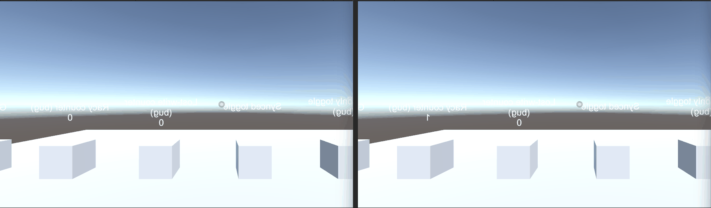

### 3.4 Fix it and check

Press **Own** (take ownership) in C0's row, then **Interact** in C0's row. With a single owner writing, every client ends
with the same value. Tick **every 2 s** to keep comparing.

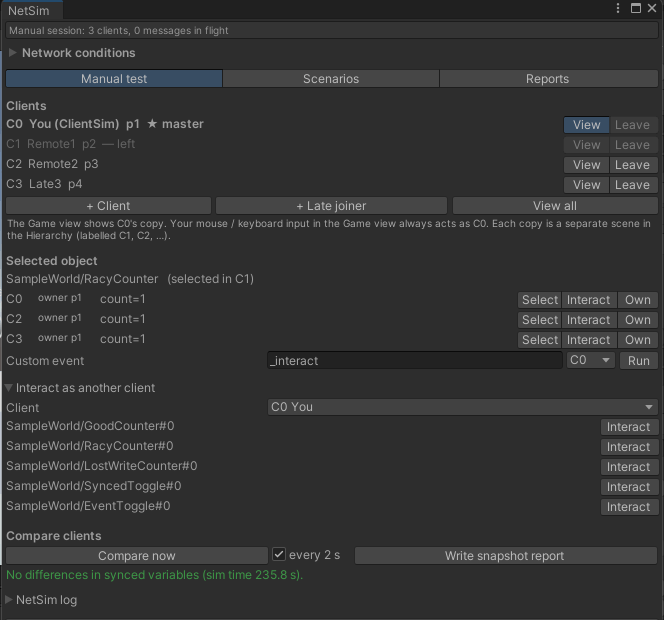

**Custom event** runs any event (not only `_interact`) as the chosen client. **Interact as another client** lists what
that client can interact with right now.

### 3.5 Late join and leave

Press **+ Late joiner** to add a late joiner and **Leave** in C1's row to make C1 leave. A late joiner receives the
server's latest state. Making the master leave tests master migration (C0 cannot leave; use the `master-leave` scenario).

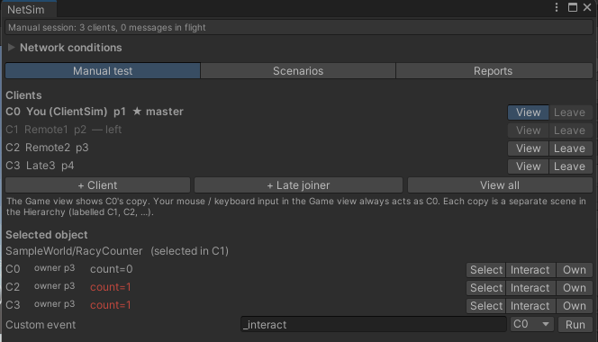

### 3.6 Keep a record

**Write snapshot report** saves the differences, visible differences, network statistics and the log to
`Logs/NetSim/snapshot_*.md`. **NetSim log** shows joins, leaves and rejected serializations.

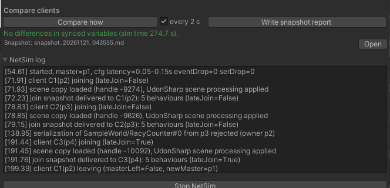

**Stop NetSim** ends the session: the copies and their players are removed and only C0 remains.

## 4. Let scenarios play (Scenarios)

### 4.1 Run one

On the **Scenarios** tab, choose a **Scenario**. The four `(built-in)` ones work on any world; `sample-world` is made for
the sample world and checks that exactly the planted bugs are found.

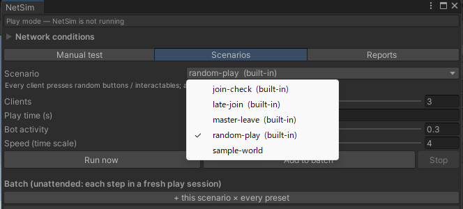

Select `sample-world` and press **Run now**.

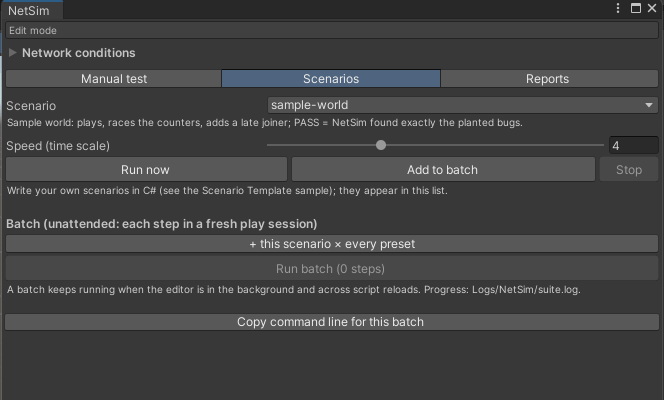

Run now always starts a fresh play session (in play mode it stops and re-enters play mode), so earlier experiments do
not change the result. **Speed** makes the editor run faster (network delays stay in simulated time). While it runs,
the top of the window shows the progress and the Hierarchy shows the clients the scenario added (`Early1`, ...).

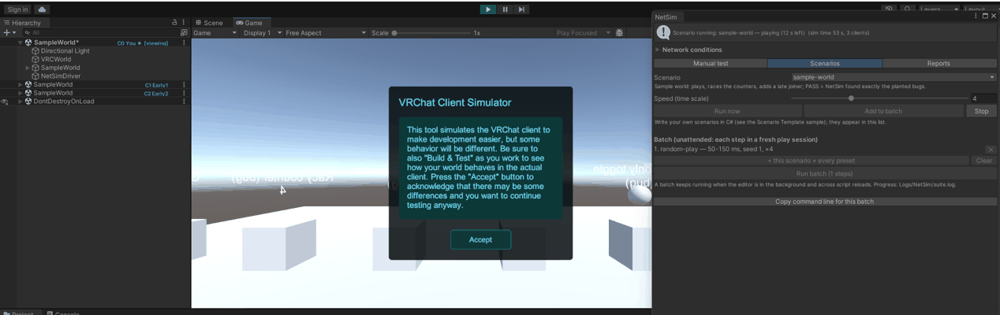

### 4.2 Read the result

The report appears in the **Reports** tab. **View** shows it in the window (**Open** opens it in the default app).

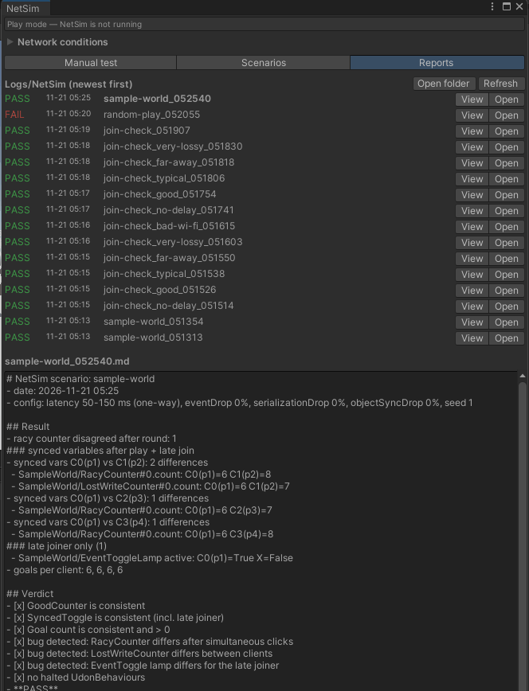

- **Result**: synced variables that differ between clients, and visible differences only a late joiner has
- **Verdict**: the scenario's checks; **PASS** when all are ticked, **FAIL** otherwise
- **Totals**: network statistics, objects with many `SetOwner` calls, behaviours halted by an Udon exception

In `sample-world`, the correct patterns (GoodCounter, SyncedToggle, goal count) agree and the three planted bugs are found,
so it passes. On your own world, `random-play` and the other built-in scenarios report diverging synced variables as FAIL.

After a scenario, play mode stays on and the copies stay loaded (`(stopped)` in the Hierarchy) so you can inspect them
in the Inspector. They are removed when NetSim starts again.

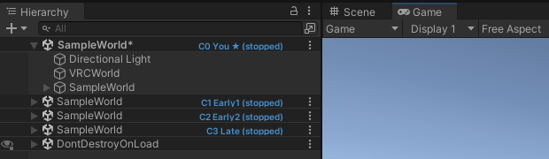

### 4.3 Many conditions at once

**+ this scenario × every preset** fills the **Batch** with the selected scenario under every preset (**Add to batch**
adds one step with the current conditions). ▲ reorders, ✕ removes.

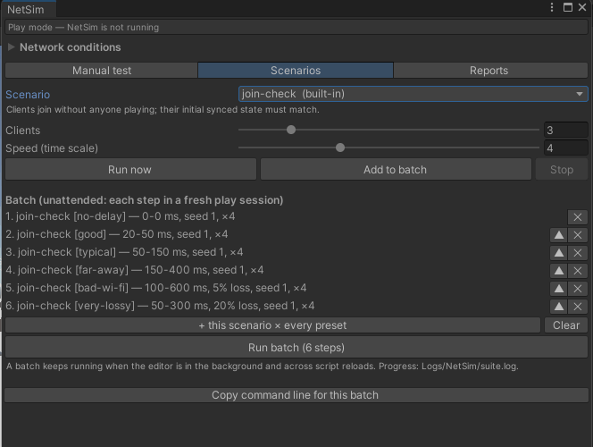

**Run batch** runs the steps one by one, each in a fresh play session, also while the editor is in the background.
**Stop** cancels. Results appear under **Results of the last batch**; **View** jumps to the report.

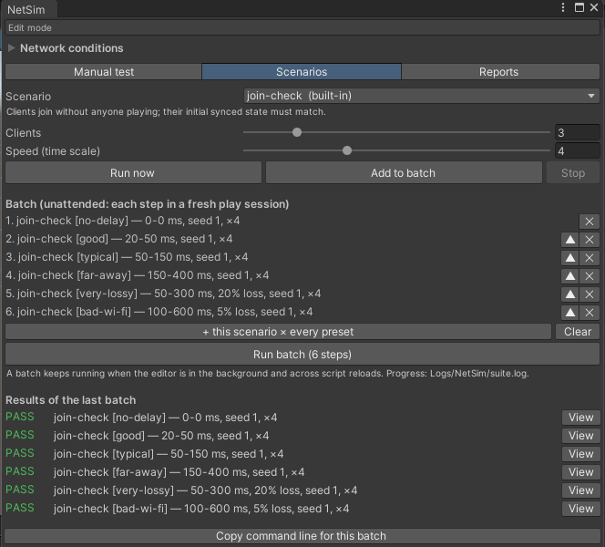

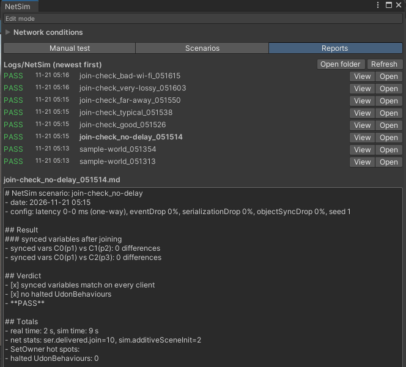

**Copy command line for this batch** copies a command that runs the same batch without the Unity window, for CI or an
AI agent (exit code 0 = all PASS, 2 = a FAIL, 1 = error; see
[Command line](../../Packages/net.haselab.netsim/Documentation~/README.md#command-line)).

## 5. On your own world

1. Open your world scene and do the same: press things in **Manual test**, run `random-play` and `late-join`.
2. The built-in scenarios press random things. A scenario that plays your game finds far more: import the
   **Scenario Template** sample from the Package Manager and adapt it
   ([Writing scenarios](../../Packages/net.haselab.netsim/Documentation~/README.md#writing-scenarios)).
3. NetSim is a simplified model. Confirm important results in real VRChat clients (the optional
   [NetSim Real Client Test](../../Packages/net.haselab.netsim.realclient/README.md) package).
